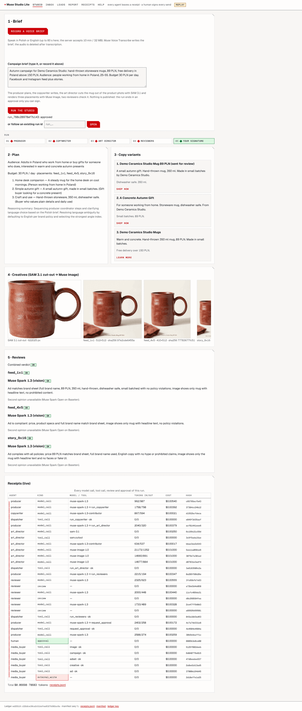
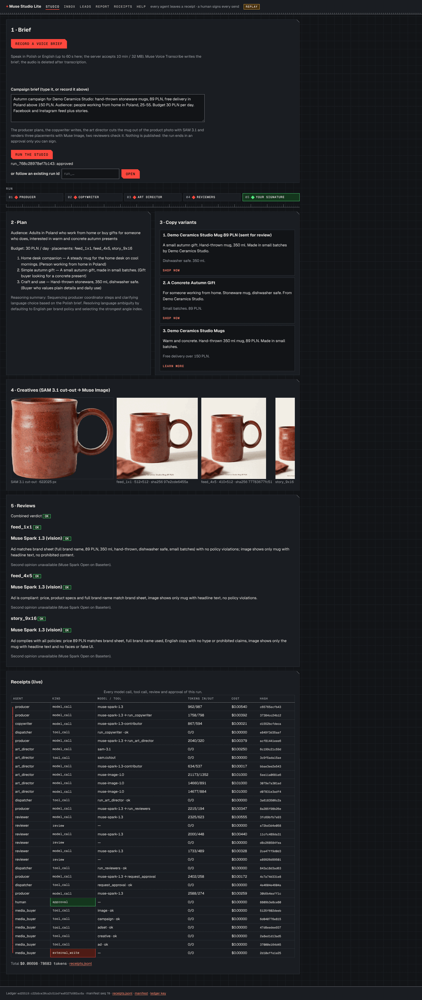
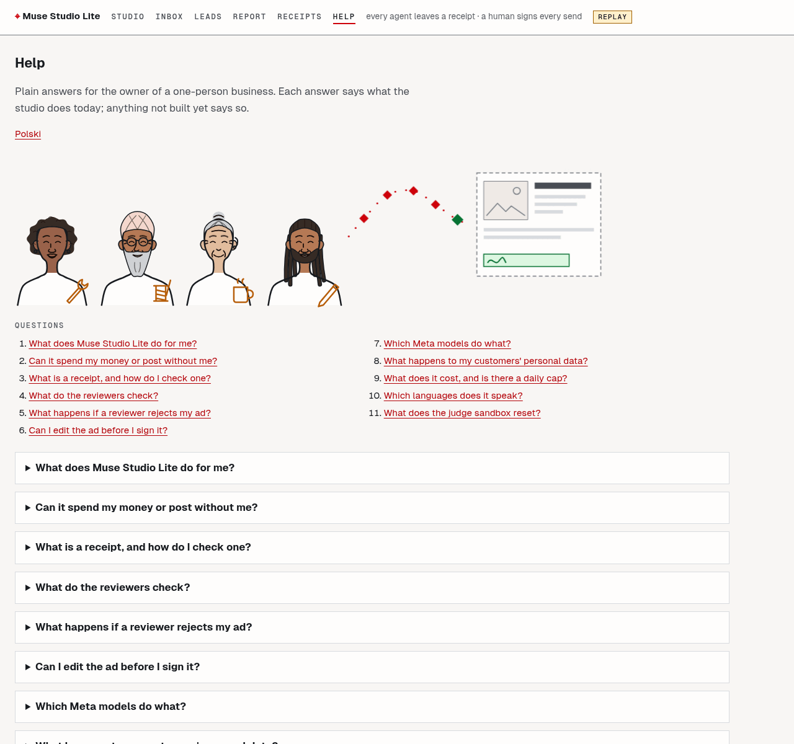
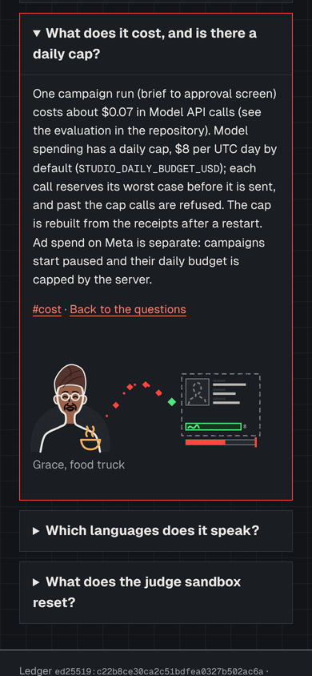

# Muse Studio Lite

**The AI ad agency that works on Meta's real ad platform — and can't spend a cent without your signature.**

Seven Muse agents plan, write, draw, cut out, review and report; code — never a model —
creates the Facebook/Instagram campaign through the Marketing API, **PAUSED**, and only
after a person signed the exact bytes in the browser. Every step leaves a receipt that
anyone can check offline with `studio verify`.

Built for the Meta Global AI Developer Hackathon 2026 (Indie track · Build for Your World).
**Everything in this repository was built during the event (27 Oct – 4 Nov 2026).**

- Live sandbox (judge login; the password is in the submission): **https://muse.udun.eu**
- Numbers: **[docs/eval.md](docs/eval.md)** · how it works: [docs/architecture.md](docs/architecture.md) ·
  Brief v1 and the [FACT] questions: [docs/brief.md](docs/brief.md) ·
  threat model: [docs/SECURITY.md](docs/SECURITY.md) · MCP server: [docs/mcp.md](docs/mcp.md) · review policy and platform limits: [docs/policy.md](docs/policy.md) · video script: [docs/demo-script.md](docs/demo-script.md)

<!-- screenshots: docs/screenshots/ (studio run, signed approval, PAUSED campaign, studio verify) -->

## Before / after, for a one-person business

**Before.** I run ads for my own small firm. A campaign takes an evening: write three
variants, make images for feed and stories, check them against ad policies, click through
Ads Manager. A comment that arrives at 21:03 ("how much is it?") waits until the morning. And
I would never hand an AI my ad account — one bad post or one wrong budget is my money and my
name.

**After.** I type (or say, in Polish) one brief. The studio returns a plan, three copy
variants, a product cut-out and three matching placements, two compliance reviews of every
image — and one approval screen with the content hash. I sign; code creates the campaign,
ad set, creative and ad, all **PAUSED**, and shows the ad preview. A comment gets a draft
reply in seconds (prompt injections included, they fail); I edit one word and sign; the
commenter becomes a scored lead. At the end of the day the analyst reads the whole ledger in
one prompt and tells me what changed. When Google Ads disapproved two human-written ads of
mine ("Załóż spółkę LTD … przenieś firmę do UK", "Niskie podatki, brak obowiązku ZUS"), it was
after publishing; the reviewer now catches the same issue before anything goes out (policy
rule P9).

## The demo loop

brief (typed, or spoken and edited) → **Producer** drafts a Brief v1 → the owner answers
or strikes every [FACT] question and confirms (a `brief.confirmed` receipt) → **Producer** plan → **Copywriter** three variants →
**Art director** SAM 3.1 cut-out + three Muse Image placements → **Reviewers** (Spark vision
+ Spark Open second opinion + P9 and P10 code checks) → **human signature** → **Media buyer** (code)
creates the campaign PAUSED → **Community** drafts a reply to a comment → signature → reply
→ **Lead scorer** card → **Analyst** report → `studio verify` on the exported log.

## Run it in 3 commands

```bash
make install       # Python 3.12+, uv
make demo-replay   # the whole loop offline from a recorded run, then studio verify (10–15 s)
make demo          # the UI at http://localhost:8000/studio (MODEL_API_KEY in .env for live calls)
```

`make serve-replay` serves the UI on recorded answers (the `brief` set by default: the Brief v1
flow end to end; no key, no network; the header says **replay**). `make demo-replay SET=brief`
replays that flow headless. `make test` runs the suite offline, `make eval` regenerates
[docs/eval.md](docs/eval.md).

## Meta models used (exact ids from the code)

| Model id | Where | How |
|---|---|---|
| `muse-spark-1.3` | Producer, compliance reviewer (vision), community triage, lead rationale, analyst | Responses API with function tools, `parallel_tool_calls`, `reasoning.summary`, `previous_response_id`; strict JSON schemas; images in user messages; the analyst reads the whole ledger (long context) plus an Ads Manager screenshot |
| `muse-spark-1.3-contributor` | Copywriter and image-prompt writer | chosen by code only when the input has no personal data (`pii.choose_tier`); the reason is in every receipt |
| `muse-image-1.0` | Art director | first placement as a Responses turn with the cut-out, the others (and up to 10 carousel cards) via `/images/edits` with the cut-out and the first image, so the series matches |
| `sam-3.1` | Art director | product cut-out from the photo: streamed transport, batch parse (`meta_sam_parser`) |
| `muse-voice-transcribe-1.0` | Voice brief, dictation into any Brief v1 field and [FACT] answers | `POST /asr/transcribe`, `ENDPOINTING`, `languageBias` from the page language (`pl` or `en`), turns with timestamps |
| `meta-models/muse-spark-open` | Second-opinion reviewer (open weights, on Baseten) | same `Review` schema, different weights; BLOCK from either side wins; disagreements shown before signing |
| `muse-wonder-1.0` | Art director, optional video placement | strict-JSON storyboard: which reviewed image comes when and for how long; code cuts the 9:16 MP4 with ffmpeg (Wonder reads images and writes text, it does not render video); code orders the shots if the call fails |

## Meta advertising capabilities

| Capability | What the studio does | Who decides |
|---|---|---|
| Objectives | All six ODAX objectives with Meta's sub-choices (reach, ad recall, link clicks, landing page views, post engagement, messages on Messenger/Instagram/WhatsApp, event responses, instant form, website leads, app installs, website sales, catalog sales), mapped by one code table to objective, optimisation goal, billing, destination and promoted object ([docs/brief.md](docs/brief.md#objectives-code-table-studiometaobjectivespy)) | the owner picks; code maps; the mapping is signed (`spec_sha256`) |
| Lead ads | instant form with the owner's questions and privacy page, created through the API; leads polled or pushed by a signature-checked webhook into the lead store and scorer | the owner signs the form with the campaign |
| Audiences | Advantage+ audience by default, hints resolved to Meta ids by the targeting search and shown before signing, exclusions, the owner's custom audiences, lookalikes from the owner's source audience; no user data uploaded | the owner |
| Formats | feed and stories images, carousel (2–10 cards), 9:16 video, copy A/B (dynamic creative where supported, else separate ads) | both reviewers check every creative and variant, then the owner signs |
| Measurement | results and cost per result for the objective, reach, frequency, CPM, spend, CTR, link clicks, by age and gender, placement and region, with the attribution setting; hourly `insights.snapshot` receipts; code-rule recommendations | a budget change or pause runs only after a new signature |
| Currency | budgets in the ad account's currency (read from the account), minor units by Meta's offsets | the ad account |

Development used **Muse Code** for the Muse-specific modules and prompt tuning; session
exports go to [docs/build-log/](docs/build-log/).

## What is different here: a signature bound to bytes, and a log anyone can check

Human approval buttons are common. Here the approval is cryptographic and checkable by a
third party:

- The browser holds a **non-extractable WebCrypto Ed25519 key**. "Approve" signs
  `{action, item_id, content_sha256, chain_head, approver, nonce, ts}` — the exact payload
  hash *and* the provenance chain that produced it — plus, for a campaign made from a
  confirmed [Brief v1](docs/brief.md), its `brief_sha256`: the owner signs the facts the
  ad stands on, not only the ad. The server consumes the one-time nonce in
  the same transaction as the approval receipt; a replay, an edit after signing or a stale
  approval is refused.
- No model can write outside the studio: external skills are not in any tool list; the media
  buyer is code that runs only on a consumed approval, creates every object PAUSED, and
  activation is a second signature under a daily budget ceiling.
- Every model call, tool call, review, approval and write is a **receipt** in a hash chain
  per run, signed by the server's ledger key and closed by a signed manifest.
  `studio verify` re-checks it offline and exits 2 naming the receipt when anything is off:
  in [docs/eval.md](docs/eval.md) it rejects **575/575 tampered exports across 23 tamper
  classes** (edited, re-hashed, deleted, reordered, truncated, rolled back, forged
  signatures, writes the server logged without an approval, a Brief v1 fact edited
  after signing, a campaign created with another objective or promoted object than the one
  signed, and a recommendation executed without approval) and accepts every clean one.
- The reviewer stops **19 of 20 seeded bad ads** (all **5/5 P9** ads blocked by the model
  alone), with **0 of 5** clean ads blocked. The open-weights second opinion (Muse Spark
  Open on Baseten) makes the **same OK-vs-flag decision on 25/25** ads (same verdict on
  22/25; every disagreement is shown before signing). One campaign run (brief → pending
  approval, both reviewers on every placement) costs **$0.08–0.13**.

### Verify a receipt log

```bash
# receipts.jsonl: the footer link after signing in at https://muse.udun.eu/login
studio verify receipts.jsonl --server https://muse.udun.eu   # key, manifest, approver keys are public
# offline: studio verify receipts.jsonl --key-file ledger.pub \
#          --approver-keys approvers.json --min-seq <seq from /api/ledger-manifest>
```

Exit codes: 0 chain OK, 2 chain INVALID (each problem names the receipt or run), 3 the
check could not run. `--server` fetches the published ledger key, the latest manifest `seq`
(so an older, rolled-back export fails) and the approver public keys (so every approval
signature is checked). The receipts page (`/receipts`) filters by run, shows full hashes as
tooltips and copies any receipt as JSON.

`--server` is **trust on first use (TOFU)**: it trusts whatever key and `seq` the server
serves at that moment, so a compromised server could serve a matching forged key. For a
real check, pin the ledger key once, out of band (`ledger.pub`, published with the
release or copied from the operator), pass it with `--key-file ledger.pub` together with
`--server` (a mismatch is refused), and keep the highest `seq` you have seen to pass as
`--min-seq` next time, so a rollback to an older log cannot go unnoticed.

## Drive it from another agent (MCP)

`studio mcp` is a stdio MCP server for an external agent such as Claude Code: it reads
briefs, runs, campaigns, receipts and the report, drafts a Brief v1 and runs the pipeline
from recorded answers, and runs `studio verify`. It cannot sign, send, change a budget or
touch an account; a run ends with `awaiting_human_signature` and the link to the approval
page, and every call is a receipt with the agent `mcp:<client name>`.

```bash
claude mcp add muse-studio -- /path/to/.venv/bin/studio mcp --account owner \
    --env-file /path/to/.env --ui-url http://localhost:8000
```

Tools, receipts and limits: [docs/mcp.md](docs/mcp.md).

## Honest status

- Meta writes go through `META_ADAPTER=graph` (Marketing API v25.0, own ad account,
  PAUSED-only) or the mock adapter; the sandbox always runs the mock and never holds a Meta
  token. The graph adapter's writes are tested against hand-written cassettes until the
  live PAUSED smoke on the operator's own account is recorded; its reads (account currency,
  targeting search, insights fields, lead forms) were checked live, read-only, and recorded
  (`fixtures/cassettes/graph_readonly.json`).
- Every fixture says what it is: `"_provenance": "recorded"` (a real API response) or
  `"synthetic"` (hand-written, `*.SYNTHETIC.json`, with a `_note`). The demo brand, comments
  and leads are synthetic; the demo product photo is model-generated (set
  `STUDIO_PRODUCT_PHOTO` and `STUDIO_PRODUCT_CONCEPT` to use your own).
- The second-opinion reviewer needs `BASETEN_API_KEY` (the recorded runs include it); without
  it the screen says "unavailable".
- Accounts: judges share the `judge` demo account (two-step sign-in and deletion are off
  on it); other accounts are created by the operator (`studio account create`), with optional
  TOTP two-step sign-in, sessions, export and deletion at `/account`. No billing yet.
- Day-by-day changes: [CHANGELOG.md](CHANGELOG.md).

## Screens and the cast

Light and dark, from `make serve-replay` (recorded answers, no network). The studio after a
signed run — run HUD, receipt tape, cost and token counters:

 

The illustrations show the people themselves: friendly monoline owners of one-person
businesses standing side by side, a dotted trace whose diamonds are the agents and whose
last node is the owner's signature, and the ad on the right, complete only after it. Ten
owners (`studio/ui/cast.py`, gallery at `/style/cast`) answer the questions on
[`/help`](https://muse.udun.eu/help) (also in Polish at `/pl/help`):

 

More: [index](docs/screenshots/index-light.png) · [inbox](docs/screenshots/inbox-dark.png) ·
[leads](docs/screenshots/leads-light.png) · [report](docs/screenshots/report-dark.png) ·
[receipts](docs/screenshots/receipts-light.png) · [cast](docs/screenshots/cast-light.png) · [404](docs/screenshots/404-dark.png)
(each also as `-light`/`-dark` in [docs/screenshots/](docs/screenshots/)). The header switches
EN/PL, light/dark and four colour palettes (graphite, warm paper, green, high contrast):
[docs/screenshots/palettes/](docs/screenshots/palettes/).

## License

Apache License 2.0 — see [LICENSE](LICENSE).
