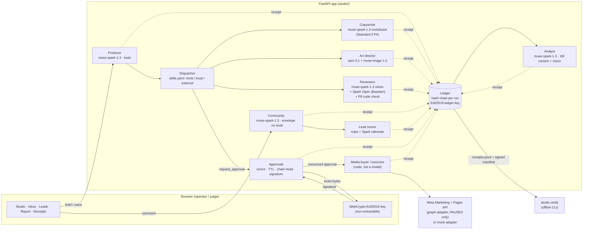

# Architecture

## The loop

- **Models only draft.** No model has a tool that writes outside the studio: the dispatcher
  builds the producer's tool list from `skills.yaml` and never includes an `external` skill;
  `request_approval` only creates a pending approval for a payload built by code.
- **A human signs the exact bytes.** The approval message binds the content hash, the run's
  chain head, a one-time nonce and the time; the browser's non-extractable key signs it.
- **Only code with a consumed approval reaches Meta.** The media buyer and the inbox sender
  run after the approval transaction committed, re-check the approval in the database, and
  create every object `PAUSED`; activation is a second signed approval under a budget
  ceiling.
- **Everything leaves a receipt**, and `studio verify` re-checks the whole log offline.

## Brief v1

A run can start from a confirmed **Brief v1** ([brief.md](brief.md)): the producer drafts
it from the owner's text or edited voice transcript (`POST /api/briefs/draft`), the owner
answers or strikes every open `[FACT]` question and confirms (`POST /api/runs` with
`brief_v1`), and a `brief.confirmed` receipt with its `brief_sha256` is written in the same
transaction that starts the run. The copywriter gets only the confirmed facts, the
reviewers check them (rule P10), and the `campaign.create` approval signs `brief_sha256`
next to the content hash; `studio verify` checks that binding.

## Meta capabilities

Everything below is code; models only draft copy, images, the video's shot order and the
analyst's prose. Every write still needs a consumed, signed approval and creates objects
PAUSED.

| Capability | Module | What happens | Graph API (v25.0) |
|---|---|---|---|
| Six objectives | `studio/meta/objectives.py` | The Brief v1 goal and sub-choice select one row of a table (objective, optimisation goal, billing event, destination type, promoted object, creative kind, call to action, insights result). `delivery` puts that row into the `campaign.create` payload; `Pending.create` signs its hash as `spec_sha256`; `objectives.check` (both adapters) refuses anything that is not a row or promotes another Page. | `POST /act_{id}/campaigns`, `/adsets` |
| Lead ads | `studio/leadads.py` | The instant form (owner's questions and privacy page) is a signed block, created before the creative; leads are polled or pushed by the `leadgen` webhook (HMAC `X-Hub-Signature-256` with `META_APP_SECRET`, refused otherwise), stored once per Meta lead id and scored by the lead scorer's rules. | `POST /{page_id}/leadgen_forms`, `GET /{form_id}/leads`, `GET /{lead_id}` |
| Audiences | `studio/meta/audience.py` | Advantage+ audience by default; interest and language hints resolved through the targeting search (read-only, a `targeting.search` receipt) and listed on the approval screen; exclusions; the owner's custom audiences; a lookalike of the owner's source audience. | `GET /search?type=adinterest\|adlocale`, `POST /act_{id}/customaudiences` |
| Formats | `studio/agents/art_director.py`, `video.py`, `meta/adapter.py` (`ads_plan`, `creative_spec`) | Carousel cards and a 9:16 video (shots ordered by `muse-wonder-1.0`, cut by ffmpeg, poster reviewed); copy A/B as dynamic creative (`asset_feed_spec`, `is_dynamic_creative`) where the optimisation goal supports it, else one ad per variant. Activation activates every ad, then the ad set, then the campaign. | `POST /act_{id}/adimages`, `/advideos`, `/adcreatives`, `/ads` |
| Measurement | `studio/meta/measurement.py` | Objective-aware insights and breakdowns into an `insights.snapshot` receipt and the `insights_snapshots` table; code rules make recommendations; an executable one becomes a signed `campaign.update` (`media_buyer.update`: one budget change under the ceiling, or a pause). | `GET /{campaign_id}/insights`, `POST /{adset_id}` `daily_budget`, `POST /{campaign_id}` `status=PAUSED` |
| Currency | `studio/meta/currency.py` | The ad account's currency (`GET /act_{id}?fields=currency,timezone_name`, read once) is the brief's and the ceiling's; minor units by Meta's offsets. | — |

`studio verify` adds two rules: a `campaign` or `ad set` step under a spec-signed approval,
and any step or write that names a `spec_sha256`, must name the one the human signed; a
`campaign.update` step or write follows the same approval-before-write rules as every
other action.

The measurement rules (thresholds in the module): a placement whose cost per result is
1.5× the campaign's while taking 20 % or more of the spend is reported (Advantage+
placements shift budget themselves; information only); spend of two daily budgets with no
result proposes a pause; an average frequency of 4 or more proposes a 20 % lower budget;
results at a frequency under 2 propose a 20 % higher budget, capped at the ceiling.

## Replay mode

`STUDIO_REPLAY=1` swaps the HTTP transport of the Model API, Baseten and Graph clients for
`studio.replay.ReplayTransport`, which serves recorded responses
(`fixtures/replay/<set>/replay.json`, large payloads in `fixtures/replay/blobs/`) keyed by a
hash of the normalized request (images out, run ids and timestamps folded). Everything else
— dispatcher, approvals, signatures, adapters, receipts, verify — runs unchanged. Receipts
name the provider `meta-model-api-replay`. `make demo-replay` drives the whole loop headless
through the HTTP API (`studio/demo.py`) and ends with `studio verify`.

## Trust model in one paragraph

Agents (Muse models) only ever produce drafts. Every model call, tool call, review and
approval is a **receipt** in a hash chain per run, signed by the server's Ed25519 **ledger
key** (`var/ledger.key`, mode 0600; public half in `var/ledger.pub` and at
`/api/ledger-key`). An external write (post a reply, create a campaign) needs a
**human approval**: the browser signs, with its own non-extractable Ed25519 key, the exact
content hash, the run's chain head, a one-time nonce and the issue time. The server
verifies the signature and consumes the nonce in the same SQLite transaction that records
the approval receipt. The signed message contains only opaque values (internal item id,
content hash, chain head, approver key id, nonce, ts), so approval receipts keep it
byte-exact without carrying PII; readable content never enters a receipt, only its hash.
`studio verify` re-checks everything offline.

## Data (SQLite, WAL) — `studio/db.py`, `studio/store.py`, `studio/approvals.py`

| Table | Purpose | Notes |
|---|---|---|
| `runs` | one row per agent run | created on first receipt |
| `receipts` | the ledger | `seq` order, full receipt JSON in `body`; `UNIQUE(run_id, prev)` forbids forks; `hash` unique |
| `ledger_meta` | single row: `key_epoch`, `seq` | `key_epoch` = fingerprint of the ledger key (signed into each manifest); `seq` = durable ledger version, bumped in the same transaction as every receipt write; never decreases |
| `approvals` | pending / approved human approvals | `content_sha256`, `chain_head`, `nonce` (unique), `ts`, `brief_sha256` and `spec_sha256` (signed when set), then `approver`, `signature`, `decided_ts` |
| `nonces` | consumed nonces | primary key = nonce; the insert is the atomic "exactly once" step |
| `keys` | approver public keys | id = `ed25519:<fingerprint>`; session stored only as a SHA-256; `expires_ts` = session expiry, `revoked_ts` set on logout and on restart; inactive keys cannot sign new approvals but stay published so past approvals verify |
| `briefs` | campaign briefs (text or voice transcript) | Brief v1: `draft`, `draft_run_id`, `brief_v1` (confirmed, JSON) and `brief_sha256` |
| `creatives` | generated images per placement | file path + SHA-256 |
| `campaigns` | campaigns created through the Meta adapter | `status` is `PAUSED` unless a second approval activates it; `external_id`, `adset_external_id`, `ad_external_id` (and `more_ad_ids` for A/B variants, carousel and video ads) are the Meta objects that approval names (activated ads → ad set → campaign); `currency` is the ad account's |
| `comments` | incoming comments (untrusted text) | `new / drafted / replied / hidden` |
| `leads`, `tasks` | lead cards and follow-ups | instant-form leads carry `external_id` (unique) and `form_id` |
| `lead_forms` | instant forms this studio created | the webhook accepts only these forms |
| `insights_snapshots`, `recommendations` | measurement snapshots and code-made recommendations | a recommendation is `open`, `requested` (an approval exists), `executed` or `failed` |
| `reports` | analyst reports | |
| `sandbox_meta` | key/value, e.g. `last_reset` | |

`reset_demo(keep_receipts=True)` deletes the demo tables and pending approvals and
re-seeds them in one transaction, writing `last_reset` last. Receipts, runs, consumed nonces
and approver keys are always kept unless `keep_receipts=False` (receipts and runs only), and
even then `ledger_meta.seq` advances.

Seed data (`fixtures/seed/*.json`) is synthetic: e-mails only `@example.com`, phones only
`+48 000 000 xxx`; `seed()` refuses anything else.

## Export and verification

`GET /api/receipts.jsonl` returns every receipt plus one signed manifest
`{seq, ts, epoch, runs: {run: {head, count}}}` taken from one consistent snapshot.
`GET /api/ledger-manifest` returns the current signed manifest; its `seq` is the
`--min-seq` for `studio verify`, which then rejects truncated, re-ordered, edited or
rolled-back logs, approvals not signed by a registered approver key
(`/api/approver-keys`), and external writes without a matching approval.
