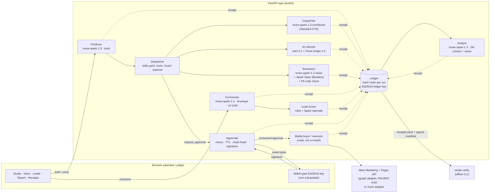

# Architecture

## The loop

- **Models only draft.** No model has a tool that writes outside the studio: the dispatcher
  builds the producer's tool list from `skills.yaml` and never includes an `external` skill;
  `request_approval` only creates a pending approval for a payload built by code.
- **A human signs the exact bytes.** The approval message binds the content hash, the run's
  chain head, a one-time nonce and the time; the browser's non-extractable key signs it.
- **Only code with a consumed approval reaches Meta.** The media buyer and the inbox sender
  run after the approval transaction committed, re-check the approval in the database, and
  create every object `PAUSED`; activation is a second signed approval under a budget
  ceiling.
- **Everything leaves a receipt**, and `studio verify` re-checks the whole log offline.

## Replay mode

`STUDIO_REPLAY=1` swaps the HTTP transport of the Model API, Baseten and Graph clients for
`studio.replay.ReplayTransport`, which serves recorded responses
(`fixtures/replay/<set>/replay.json`, large payloads in `fixtures/replay/blobs/`) keyed by a
hash of the normalized request (images out, run ids and timestamps folded). Everything else
— dispatcher, approvals, signatures, adapters, receipts, verify — runs unchanged. Receipts
name the provider `meta-model-api-replay`. `make demo-replay` drives the whole loop headless
through the HTTP API (`studio/demo.py`) and ends with `studio verify`.

## Trust model in one paragraph

Agents (Muse models) only ever produce drafts. Every model call, tool call, review and
approval is a **receipt** in a hash chain per run, signed by the server's Ed25519 **ledger
key** (`var/ledger.key`, mode 0600; public half in `var/ledger.pub` and at
`/api/ledger-key`). An external write (post a reply, create a campaign) needs a
**human approval**: the browser signs, with its own non-extractable Ed25519 key, the exact
content hash, the run's chain head, a one-time nonce and the issue time. The server
verifies the signature and consumes the nonce in the same SQLite transaction that records
the approval receipt. The signed message contains only opaque values (internal item id,
content hash, chain head, approver key id, nonce, ts), so approval receipts keep it
byte-exact without carrying PII; readable content never enters a receipt, only its hash.
`studio verify` re-checks everything offline.

## Data (SQLite, WAL) — `studio/db.py`, `studio/store.py`, `studio/approvals.py`

| Table | Purpose | Notes |
|---|---|---|
| `runs` | one row per agent run | created on first receipt |
| `receipts` | the ledger | `seq` order, full receipt JSON in `body`; `UNIQUE(run_id, prev)` forbids forks; `hash` unique |
| `ledger_meta` | single row: `key_epoch`, `seq` | `key_epoch` = fingerprint of the ledger key (signed into each manifest); `seq` = durable ledger version, bumped in the same transaction as every receipt write; never decreases |
| `approvals` | pending / approved human approvals | `content_sha256`, `chain_head`, `nonce` (unique), `ts`, then `approver`, `signature`, `decided_ts` |
| `nonces` | consumed nonces | primary key = nonce; the insert is the atomic "exactly once" step |
| `keys` | approver public keys | id = `ed25519:<fingerprint>`; session stored only as a SHA-256; `expires_ts` = session expiry, `revoked_ts` set on logout and on restart; inactive keys cannot sign new approvals but stay published so past approvals verify |
| `briefs` | campaign briefs (text or voice transcript) | |
| `creatives` | generated images per placement | file path + SHA-256 |
| `campaigns` | campaigns created through the Meta adapter | `status` is `PAUSED` unless a second approval activates it; `external_id`, `adset_external_id`, `ad_external_id` are the Meta objects that approval names (activated ad → ad set → campaign) |
| `comments` | incoming comments (untrusted text) | `new / drafted / replied / hidden` |
| `leads`, `tasks` | lead cards and follow-ups | |
| `reports` | analyst reports | |
| `sandbox_meta` | key/value, e.g. `last_reset` | |

`reset_demo(keep_receipts=True)` deletes the demo tables and pending approvals and
re-seeds them in one transaction, writing `last_reset` last. Receipts, runs, consumed nonces
and approver keys are always kept unless `keep_receipts=False` (receipts and runs only), and
even then `ledger_meta.seq` advances.

Seed data (`fixtures/seed/*.json`) is synthetic: e-mails only `@example.com`, phones only
`+48 000 000 xxx`; `seed()` refuses anything else.

## Export and verification

`GET /api/receipts.jsonl` returns every receipt plus one signed manifest
`{seq, ts, epoch, runs: {run: {head, count}}}` taken from one consistent snapshot.
`GET /api/ledger-manifest` returns the current signed manifest; its `seq` is the
`--min-seq` for `studio verify`, which then rejects truncated, re-ordered, edited or
rolled-back logs, approvals not signed by a registered approver key
(`/api/approver-keys`), and external writes without a matching approval.
